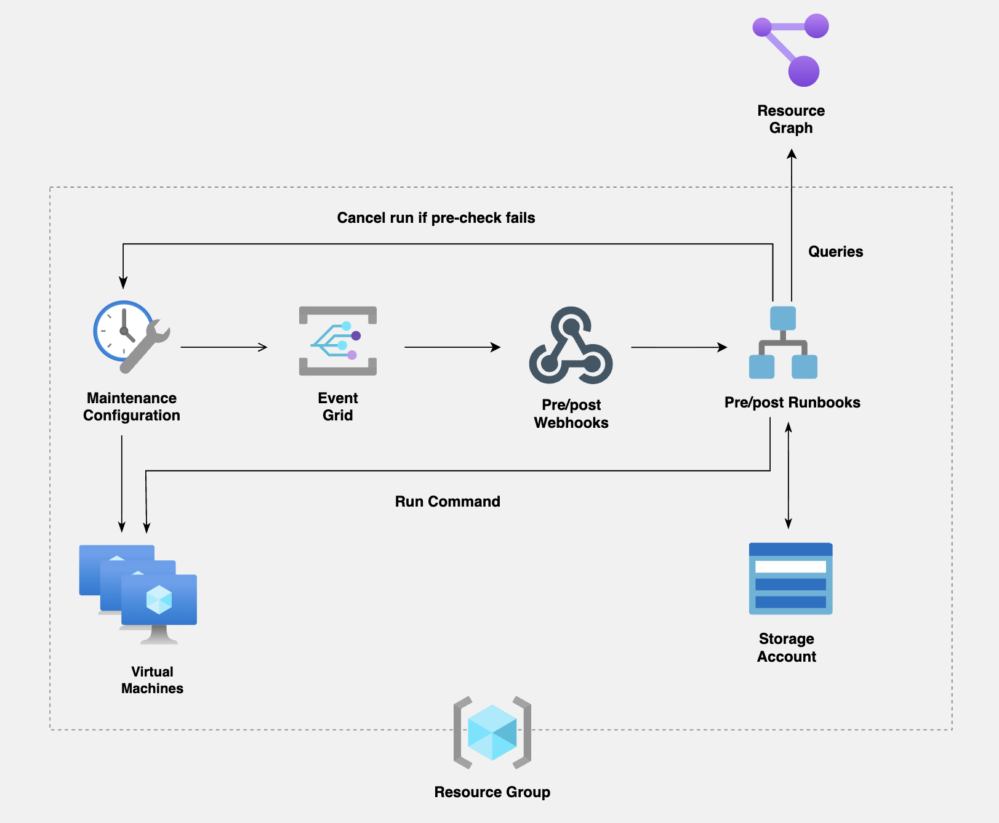

# Azure Patch Management Automation Lab

Automated pre- and post-patch health checks around Azure Update Manager scheduled patching. Terraform builds the lab, PowerShell does the checks, Azure Automation runbooks run them, and Event Grid triggers the runbooks from the maintenance window.
 
Before a patch window opens, a runbook checks each VM from the inside. If the pre-check script fails, the runbook cancels the maintenance run so patching doesn't occur on an unhealthy machine. If the script passes, it snapshots the OS disks and allows Update Manager to patch. After the window, a second runbook validates the VMs again. 

The compliance report is standalone runbook, ran manually from the Automation account separate from the maintenance window. It queries Azure Resource Graph across the entire fleet, displays the output to the job log, and exports it as a timestamped CSV to the `lab-report` blob container. 
## Repository Layout
 
```
.
├── powershell/
│   ├── PrePatchCheck.ps1          # runs inside the VM (via Run Command)
│   ├── PostPatchValidation.ps1    # runs inside the VM (via Run Command)
│   ├── PreEventRunbook.ps1        # Automation runbook, triggered by the pre-maintenance event
│   ├── PostEventRunbook.ps1       # Automation runbook, triggered by the post-maintenance event
│   └── ComplianceReportRunbook.ps1       # Automation runbook, fleet-wide patch report
├── terraform/
│   ├── main.tf                    
│   ├── variables.tf
│   ├── outputs.tf
│   └── .terraform.lock.hcl       
├── docs/
|   ├── architecture.png 
|   ├── screenshots/ # Lab screenshots                   
└── .gitignore
```
## Azure Resources Created

Deployed with Terraform:
- Resource group (`rg-terraform-patch-lab`)
- Virtual network and subnet, NICs, network security group
- 2 Windows Servers 2016 VM (`windows-vm`)
- Automation account 
- Runbooks for the pre-patch check, post-patch validation, and compliance report
- Storage account with containers for scripts (`lab-scripts`) and compliance reports (`lab-report`)
- Maintenance configuration for Azure Update Manager, with pre/post events
- Event Grid subscription that triggers the runbooks around the maintenance window
- Role assignments granting the managed identity access to the VM, storage, and Resource Graph data

## What Each Script Does
 
**Pre-patch (`PrePatchCheck.ps1`)**
 
- Connectivity to the Windows Update endpoints (checked first)
- Free space on the OS drive (flags below 20 GB)
- Pending reboot, from three separate indicators: Component Based Servicing, Windows Update `RebootRequired`, and pending file rename operations
- Health of the update services (`wuauserv`, `bits`, `cryptsvc`, `TrustedInstaller`), with an attempt to fix a service that's stopped or disabled

**Post-patch (`PostPatchValidation.ps1`)**
 
- Free space on the OS drive again
- The same update service checks

**Compliance report (`ComplianceReportRunbook.ps1`)**

- Latest patch installation run per VM: start time, status, and counts of installed, failed, and not-selected patches
- Latest patch assessment per VM: assessment time, status, and counts of critical and security patches still pending
- Output is printed to the job log and exported as a timestamped CSV to the `lab-report` blob container

## Architecture Diagram
 

 
## Deploying
 
### Prerequisites
 
- An Azure subscription
- [Terraform](https://developer.hashicorp.com/terraform/install) and the [Azure CLI](https://learn.microsoft.com/cli/azure/install-azure-cli)
- These resource providers registered on the subscription: `Microsoft.Automation`, `Microsoft.Maintenance`, `Microsoft.EventGrid` (plus the usual Compute, Network, and Storage)
### Steps
 
```bash
az login
az account show                     
 
export ARM_SUBSCRIPTION_ID="<your subscription id>"   
 
cd terraform
terraform init
terraform plan
terraform apply
```
